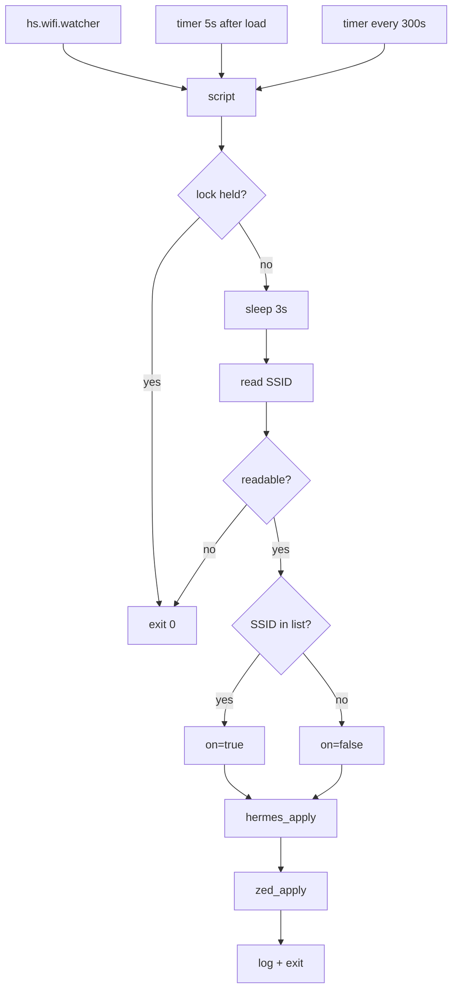

# deepseek-proxy-switch — how it works

## 1. What it does

One script, `~/bin/deepseek-proxy-switch.sh`, decides a single boolean — *should DeepSeek traffic go through my proxy right now?* — and pushes that decision into two independent config files. The decision is `true` when the current Wi-Fi SSID is in `PROXY_SSIDS`, `false` otherwise.

It never toggles, never flips, never reads the current value to decide what to do. Every run computes the desired state from scratch and writes it. That's what makes it safe to run on every network event, on a timer, and twice in a row.



## 2. The two targets

| | Hermes | Zed |
| --- | --- | --- |
| File | `~/.hermes/.env` | `~/.config/zed/settings.json` |
| Key | `DEEPSEEK_BASE_URL` | `language_models.deepseek.api_url` |
| `true` writes | `https://deepseek.fahadfaruqi.com/` | same URL |
| `false` writes | `` (empty) | `https://api.deepseek.com/v1` |
| Format | line-oriented env | nested JSON |
| Writer | `grep`/`sed` line rewrite | `jq` document-path assignment |
| Consumed | on Hermes startup | live — Zed watches the file |

The format difference is the entire reason there are two appliers rather than one parameterized one. A line-oriented `sed` cannot address a nested JSON path, and a JSON writer has no business in a `.env`.

## 3. Trigger layer

Hammerspoon, in `~/.hammerspoon/init.lua`:

```lua
require("hs.ipc")
local SCRIPT = "/Users/farquaad/bin/deepseek-proxy-switch.sh"
local function sync() ... hs.task.new("/bin/bash", callback, {SCRIPT}):start() end

hs.wifi.watcher.new(sync):start()   -- event: association changed, either direction
hs.timer.doAfter(5, sync)           -- already on a target network at login/reload
hs.timer.doEvery(300, sync)         -- backstop: wake from sleep, hs restart, missed events
```

Three sources, all hitting the same script. A burst of events is harmless: the first acquires the lock, the rest exit immediately.

Two environment facts this depends on:

- **Location Services must be granted to Hammerspoon.** Reading an SSID is gated by TCC since Sonoma. `hs.task` children inherit Hammerspoon's attribution, not the terminal's, so without the grant the script's SSID read fails and *every* run becomes a silent no-op.
- **`hs.task` runs `/bin/bash` with `PATH=/usr/bin:/bin:/usr/sbin:/sbin`**, which excludes `/opt/homebrew/bin`. The script therefore sets its own `PATH` on line 6 so `jq` resolves. Without that line, Hermes updates and Zed silently doesn't.

## 4. Control flow

`main`:

1. `acquire_lock` — on failure, exit 0 (another instance is running).
2. `sleep 3` — DHCP/DNS settle, and bursts collapse into one run.
3. `get_ssid` — `macwifi-cli info`, parsed by `awk`. The parser watches for the line whose first field is `SSID`, measures the width of the `SSID` column by locating `BSSID`, then prints the next non-empty row truncated to that width. This avoids splitting on whitespace, since SSIDs contain spaces.
4. Fail-safe `case`. If the read yields `""`, `SSID`, `<redacted>`, `-`, or anything containing "not associated" / "No Wi-Fi", log and exit **without touching either file**. Wake-from-sleep and mid-association reads land here.
5. `is_proxy_ssid "$ssid"` — exact string comparison against each array element. Exact, not a pattern match, so an SSID containing `*` can't accidentally match.
6. Call both appliers with `true` or `false`.
7. Log a summary line and exit with `rc` = 2 if either applier failed, else 0.

Neither applier is skipped if the other fails. A Zed failure does not prevent Hermes from updating.

## 5. Applier contract

Both return the same three codes, and `main` translates them into log lines:

| Code | Meaning | Log line |
| --- | --- | --- |
| 0 | wrote a new value | `-> <flag> (updated)` |
| 1 | already correct, nothing written | `-> <flag> (no change)` |
| 2 | failed, file restored | `-> <flag> FAILED` |

### `hermes_apply true|false`

```
flag → value                       (true = proxy URL, false = empty)
file exists?                       else 2
escape & for sed's replacement
build candidate in mktemp:
  key present  → sed -E 's|^(export )?KEY=.*|\1KEY=VALUE|'
  key absent   → append; add a newline first if the file lacks a trailing one
cmp candidate vs current           → identical: delete temp, return 1
cp -p current → $LOCK/hermes.env.bak
cat candidate > current            (preserves inode and permissions)
env_validate                       → pass: delete backup, return 0
                                   → fail: restore from backup, delete backup, return 2
```

### `zed_apply true|false`

```
flag → url
readable? jq present?              else 2
strict-JSON gate: jq -e .          fails on comments/JSONC → 2 (refuse, never rewrite)
shape gate: .language_models.deepseek is null or object → else 2
candidate = jq --arg u URL '.language_models.deepseek.api_url = $u'
  (creates missing intermediate objects, so an empty "language_models": {} works)
no-op check: flattened candidate == flattened current → return 1
scope gate: changed leaf set == exactly the deepseek api_url → else 2
cmp candidate vs current           → identical: return 1
cp -p current → $LOCK/zed.settings.json.bak
cat candidate > current
zed_validate                       → pass: delete backup, return 0
                                   → fail: restore, delete backup, return 2
```

`jq --arg` matters: the URL is passed as a value, never interpolated into the filter text, so no quoting surface. The `-0` reformat is accepted — every write normalizes settings.json to 2-space indent.

## 6. Validation — what "correct" means

Validation always compares the **on-disk file** against the **backup copy**, not against what the applier intended. That's the point: it verifies the write landed, not that the intent was right.

`env_validate file key expected backup`:
- exactly one line matches `^(export )?KEY=` — catches duplication, which `sed` would otherwise silently create
- that line's value equals `expected`
- `diff -B` over all *other* lines is empty — nothing else in the file moved. `-B` because appending to a file with no trailing newline legitimately adds a blank line.

`zed_validate file url backup`:
- `jq -e .` parses
- `.language_models.deepseek.api_url` equals `url`
- `zed_edit_is_scoped backup file` holds

`zed_edit_is_scoped` is the guarantee that only DeepSeek was touched. It flattens both documents to one `<json-path>\t<value>` line per scalar leaf, diffs them, and requires the changed set to be exactly `["language_models","deepseek","api_url"]`. Paths are emitted as JSON arrays so provider names containing dots stay unambiguous.

That gate is what stops a text-based approach from clobbering `openai`, `x_ai`, `mistral`, `anthropic_compatible.*`, or an `openai_compatible` provider someone named "deepseek" — all of which also key on `api_url`. It runs twice: once on the candidate before writing, once on the file after.

## 7. Locking

`/tmp/deepseek-proxy-switch.lock`, created with `mkdir` (atomic), containing a `pid` file.

- Held → `cat pid`, check `kill -0`, check directory age. Owner alive and younger than 10 minutes → log `already running`, exit 0.
- Owner gone, **or** older than 10 minutes → stale. The age check is there because pid reuse makes `kill -0` a liar. Reclaim: clear `pid` and any orphaned `.bak`, `rmdir`, retry the `mkdir` once.
- Released by `trap ... EXIT INT TERM HUP`. A `SIGKILL` leaks the directory; the stale check is what recovers from that.

`rm -f` + `rmdir`, not `rm -rf`.

## 8. Ordering rule, and the bug it caused

The appliers must check for a no-op **before** the scope gate, because `jq`'s output is never byte-identical to a hand-formatted file, and an already-correct value produces an *empty* changed-leaf set — not the expected singleton.

That ordering was wrong in Zed's applier initially: no-op → empty set → `empty != [deepseek.api_url]` → "would touch other providers, refusing". Log signature was:

```
hermes -> false (no change)
zed: edit would touch providers other than deepseek; refusing
zed -> false FAILED
ssid='Greycafe' proxy=false rc=2
```

Hermes looked fine because its `cmp` check sat first. The fix added a flattened-equality check above Zed's gate. Both appliers now follow the same order: compute → detect no-op → scope-check → back up → write → validate → commit or revert.

## 9. Log messages, for diagnosis

```
already running (pid N, Xm); exiting
stale lock (pid N, Xm); reclaiming
could not read SSID ('...'); leaving config unchanged
hermes -> <flag> (updated | no change)
zed -> <flag> (updated | no change)
hermes|zed: post-write validation failed, reverted to pre-edit state
zed: jq not installed
zed: settings.json is not strict JSON (comments?); refusing
zed: .language_models.deepseek is '<type>'; refusing
zed: edit would touch providers other than deepseek; refusing
ssid='<SSID>' proxy=<bool> rc=<0|2>
```

The two that indicate silent breakage rather than loud failure: `could not read SSID` repeating on every switch (Location permission), and `zed ... FAILED` on every switch while Hermes reports `updated` (PATH).

## 10. Known limits

- **settings.json must stay strict JSON.** A `//` comment makes `zed_apply` refuse rather than risk the file. Zed tolerates comments; this script doesn't.
- **Hermes reads `.env` at startup.** Writing it changes nothing in a running Hermes. Deliberately out of scope — no restart hook.
- **Up to 5 minutes of staleness** if the watcher misses an event, since the backstop is `doEvery(300)`.
- **Seconds of lag** after joining a network before the watcher fires; during that window DeepSeek traffic goes wherever the previous state pointed.
- **Log growth**: three lines per run, no rotation, on top of a 300s poll.
- **Exact-match SSIDs only.** No prefixes, wildcards, or BSSID matching; a hidden network or a randomized name is unmatched by definition.
- **`/tmp` lock dir** is purged on reboot, which is harmless — the lock is meant to be ephemeral. The script itself lives in `~/bin` for the same reason.

## 11. Operating it

Inspect:

```bash
tail -f ~/Library/Logs/deepseek-proxy-switch.log
grep -n api_url ~/.config/zed/settings.json
grep DEEPSEEK_BASE_URL ~/.hermes/.env
ls -d /tmp/deepseek-proxy-switch.lock 2>/dev/null || echo "lock released"
```

Force a run and read the result:

```bash
~/bin/deepseek-proxy-switch.sh; echo "rc=$?"; tail -3 ~/Library/Logs/deepseek-proxy-switch.log
```

Disable without touching files:

```bash
hs -c 'hs.wifi.watcher.stopAll()'   # session-scoped; remove the block from init.lua to persist
```

Recover a bad write: the `.bak` files in the lock dir exist only during a write. Once a run commits, the backup is gone — the previous good state is whatever you put in version control or Time Machine. If you want a longer-lived safety net, the place to add it is a timestamped copy before `cp -p`, not a permanent `.bak` next to the file.
